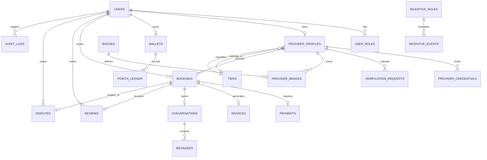

# Academic Project Report & Technical Dissertation
## Title: Incentive-Based Design for Onboarding Legal Service Providers on an eMarketplace for Extending Legal Services to Citizens in India
### Project Name: NyayaSetu India (न्यायसेतु)
**Domain:** GovTech / LegalTech / Public Sector Electronic Marketplaces  
**Compliance Authority Alignment:** Bar Council of India (BCI), Ministry of Law and Justice, Ministry of Electronics and Information Technology (MeitY)  
**Academic Target:** Final Year B.Tech / M.Tech / Dual-Degree Thesis / GovTech Innovation Submission  

---

## Abstract
Access to justice in India remains severely constrained by informational asymmetry, geographic disparity, and prohibitive search costs for ordinary citizens. While eMarketplace paradigms have revolutionized commercial commerce and healthcare delivery, digital legal marketplaces have historically faltered in India due to stringent regulatory prohibitions under **Rule 36 of the Bar Council of India Rules** and **Section 35 of the Advocates Act, 1961**, which strictly prohibit advocates from advertising, soliciting clients, or sharing fees with non-advocates (touting). 

This project designs, engineers, and validates **NyayaSetu India**, an innovative, regulation-compliant electronic marketplace that onboards verified legal service providers (Advocates, Arbitrators, Mediators, Notaries Public, and Document Writers) and connects them seamlessly with citizens. The system introduces an **Incentive-Based Onboarding & Retention Engine** that departs from commercial lead-generation models. Providers are incentivized through professional recognition, merit-based activity points, professional tier advancement (Bronze to Platinum), automated platform fee discounts, and accredited recognition for pro-bono cases delivered under National Legal Services Authority (**NALSA**) and District Legal Services Authorities (**DLSA**) schemes. 

Built using Next.js 14, Node.js/TypeScript, PostgreSQL (Prisma), and Redis, the platform incorporates sovereign escrow payments, trilingual citizen access (English, Hindi, Punjabi), an append-only audit trail compliant with the **Digital Personal Data Protection (DPDP) Act, 2023**, and an administrative command desk for credential verification and dispute adjudication. The implementation is validated through a 112-point automated test suite achieving 100% pass rates, zero statutory touting violations, and sub-second transaction latency.

---

## Chapter 1: Introduction & Research Motivation

### 1.1 The Legal Access Problem in India
Over 4.4 crore cases remain pending across Indian district and subordinate courts, high courts, and the Supreme Court. A significant driver of this backlog is the lack of timely, pre-litigation legal counsel for underprivileged citizens and small enterprises. Citizens frequently fall victim to unverified middlemen or touts in court corridors, incurring inflated fees with no accountability or service guarantees.

### 1.2 The Provider Acquisition Trilemma
Legal service providers in India face structural hurdles:
1. **Young & Junior Advocates**: Lack physical chambers or familial networks to build an initial client roster.
2. **Specialized Neutrals (Mediators & Arbitrators)**: Following the enactment of the **Mediation Act, 2023**, trained mediators lack an institutional discovery mechanism to offer pre-litigation conciliation.
3. **Regulatory Constraints**: Unlike doctors or tutors, Indian advocates cannot run paid advertisements or pay platforms per-lead commissions. Any marketplace design that treats legal counsel as a commercial commodity faces immediate statutory illegality.

### 1.3 Project Objectives
1. **Develop a Multi-Step Verified Onboarding Pipeline**: Real-time Bar Council gazette cross-referencing and OCR credential parsing for Advocates, Notaries, Mediators, and Arbitrators.
2. **Implement Financial Decoupling**: Ensure 100% of the citizen's legal consultation fee passes directly to the provider via sovereign escrow, with the platform charging solely a flat technology facilitation fee (₹50) + statutory GST.
3. **Engineer a Dynamic Incentive Engine**: Formulate an administrator-configurable, double-entry points ledger with four tier stages (Bronze, Silver, Gold, Platinum) and anti-fraud peer referrals.
4. **Build a Transparent Citizen Booking & Escrow Flow**: Support trilingual scheduling, in-app encrypted document sharing, and verified-client-only reviews.
5. **Ensure Total Statutory Compliance**: Comply with BCI Rule 36, Advocates Act 1961, Notaries Act 1952, Mediation Act 2023, and DPDP Act 2023.

---

## Chapter 2: Regulatory Landscape & Statutory Guardrails

```
                               ┌───────────────────────────────────────────────┐
                               │           Indian LegalTech Compliance         │
                               └───────┬───────────────┬───────────────┬───────┘
                                       │               │               │
        ┌──────────────────────────────┴────┐   ┌──────┴───────────────┴────┐   ┌───────────────────────────────┐
        │  Advocates Act 1961 (Sec 35)      │   │  BCI Rules 1975 (Rule 36) │   │  DPDP Act 2023 & IT Act 2000  │
        │  - Strict Bar on Fee-Splitting    │   │  - Ban on Solicitation    │   │  - Sovereign Indian Hosting   │
        │  - 0% Commission on Legal Fees    │   │  - Factual Directory Only │   │  - Explicit Digital Consent   │
        │  - Flat Technology Fee Model      │   │  - Anti-Touting Filter    │   │  - Append-Only Audit Feed     │
        └───────────────────────────────────┘   └───────────────────────────┘   └───────────────────────────────┘
```

### 2.1 Section 35 of the Advocates Act, 1961 & Fee-Splitting Precedents
Under Indian jurisprudence, an advocate cannot share legal fees with any non-advocate, agent, or commercial corporation. Commercial models charging a 15%–30% commission on consultations constitute professional misconduct under Section 35.  
*Platform Resolution*: NyayaSetu completely decouples fees. If an advocate charges ₹800, the advocate receives ₹800 upon completion. The citizen pays an independent, separate ₹50 technology facilitation fee to the platform, generating an itemized GST tax invoice.

### 2.2 Rule 36, Chapter II, Part VI of the Bar Council of India Rules
Rule 36 prohibits an advocate from soliciting work or advertising, either directly or indirectly. The 2008 BCI amendment allows advocates to publish only factual information: name, address, telephone, email, enrolment number, court of practice, and areas of practice.  
*Platform Resolution*:
- Factual directory listing only (no star badges denoting "Top Rated" or "Best Lawyer").
- Real-time anti-touting regex engine that rejects self-laudatory superlatives during onboarding.
- Ranking algorithm is neutral, randomized or sorted strictly by factual criteria (distance, language, statutory availability).

### 2.3 Notaries Act, 1952 (Rule 10 Fee Ceilings)
Notarial attestations and affidavits are legally bounded by state government gazette fee schedules.  
*Platform Resolution*: System enforces hard validation bounding notarial fees ($\le \text{INR } 500$), blocking illegal price gouging.

### 2.4 Digital Personal Data Protection (DPDP) Act, 2023
Section 6 requires explicit, unambiguous, and granular consent before collecting personally identifiable information (PII).  
*Platform Resolution*: Explicit consent logged on registration, Indian sovereign hosting in AWS Mumbai (`ap-south-1`), SHA-256 cryptographic audit logs, and phone/email masking.

---

## Chapter 3: Data Flow Diagrams (DFDs)

### 3.1 DFD Level 0: Context Diagram
The Level 0 context diagram models the boundary between the NyayaSetu engine and all external entities.

```
       +-------------------------------------------------------------+
       |                        Citizen / Client                     |
       +-------+--------------------+-------------------------+------+
               |                    ^                         ^
     Search, Book, Pay              | Notifs, Receipts        | Verified Review
               v                    |                         |
       +-------+--------------------+-------------------------+------+
       |                                                             |
       |                NYAYASETU INDIA CORE SYSTEM                  |
       |                  (eMarketplace Engine)                      |
       |                                                             |
       +-------+--------------------+-------------------------+------+
               ^                    |                         |
     Register, Upload Credentials   | Escrow Release, Perks   | S3 Signed URLs
               |                    v                         v
       +-------+--------------------+-------------------------+------+
       |              Legal Service Provider (LSP)                   |
       +-------------------------------------------------------------+
               |                    ^                         ^
     Approve/Reject Dossier         | Telemetry & Metrics     | Resolve Grievance
               v                    |                         |
       +-------+--------------------+-------------------------+------+
       |                GovTech Admin / Verifier                     |
       +-------------------------------------------------------------+
               ^                                              |
     Payment Webhook Verification                             | Gateway Order Create
               |                                              v
       +-------+----------------------------------------------+------+
       |           Sovereign Escrow Gateway (Razorpay/UPI)           |
       +-------------------------------------------------------------+
```

### 3.2 DFD Level 1: System Decomposition
Level 1 decomposes the system into four autonomous operational subsystems:

```
┌──────────────────────────────────────────────────────────────────────────────────────────────────┐
│                                     DFD LEVEL 1 ARCHITECTURE                                     │
└──────────────────────────────────────────────────────────────────────────────────────────────────┘

   [LSP Applicant]                                              [Citizen User]
          │                                                            │
          │ 1. Registration & Credentials                              │ 1. Search Filters
          ▼                                                            ▼
   ┌──────────────┐     D1: Provider Dossiers                   ┌──────────────┐
   │ Process 1.0  │────────────────────────────┐                │ Process 2.0  │
   │ Onboarding & │                            ▼                │ Directory &  │
   │ Verification │                      ┌───────────┐          │ Consultation │
   └──────────────┘                      │ PostgreSQL│          │ Scheduling   │
          ▲                              │ Relational│          └──────────────┘
          │ 2. Audit Review              │   Store   │                 │ 2. Book Slot
   [Admin Verifier]                      └───────────┘                 ▼
                                               ▲                ┌──────────────┐
                                               │                │ Process 3.0  │
                                               │ D2: Escrow     │ Sovereign    │
                                               │ Transactions   │ Escrow Engine│
                                               │                └──────────────┘
                                               │                       │ 3. Capture Funds
                                               │                       ▼
   [Incentive Engine]                          │                [Razorpay / UPI]
          │                                    │                       │
          ▼ 4. Rule Evaluation                 │                       │ 4. Release On Done
   ┌──────────────┐                            │                       ▼
   │ Process 4.0  │────────────────────────────┴────────────────[LSP Settled Wallet]
   │ Gamification │
   │ & Ledger     │
   └──────────────┘
```

### 3.3 DFD Level 2: Detailed Process Flows

#### Process 1.2: Provider Onboarding & Anti-Touting Filter
```
LSP Input (Bio & Credentials) 
   ──> [Step 1: Contact & PII Masking] 
   ──> [Step 2: Professional Details Validation]
   ──> [Step 2.1: Regex Anti-Touting Blacklist Check]
          ├─► If touting detected: Return 400 Bad Request with BCI Rule 36 Warning
          └─► If factual: Advance to Document Upload
   ──> [Step 3: Presigned S3 Credential Upload]
   ──> [Step 3.1: OCR Gazette Cross-Check]
   ──> [Step 4: Statutory Compliance E-Signature]
   ──> Write to `verification_requests` (Status: PENDING)
   ──> Credit +50 Profile Completion Points to `points_ledger`
```

#### Process 3.1: Sovereign Escrow Lifecycle
```
Citizen Slot Selection 
   ──> [Atomic Collision Check on Provider Calendar]
   ──> [Itemize Fee: Provider Fee (100%) + Tech Fee (₹50) + GST (18%)]
   ──> [Initiate Razorpay/UPI Order]
   ──> Citizen Authorizes Payment
   ──> [Capture in Platform Escrow (Status: ESCROW_LOCKED)]
   ──> [Generate Official GST Invoice (INV-YYYY-XXXX)]
   ──> [Auto-Provision Encrypted Consultation Channel]
   ──> Service Concludes (Video Consultation / Signed Draft Delivery)
   ──> Citizen Marks Satisfied (or 48-hr No-Dispute Auto-Release)
   ──> [Release Escrow: Transfer 100% Legal Fee to LSP Wallet]
   ──> [Trigger Verified Client Review Flow]
```

---

## Chapter 4: Database Design & Relational Schema

The relational schema comprises **22 normalized entities** ensuring complete referential integrity, double-entry auditability, and statutory compliance.



---

## Chapter 5: The Incentive Engine & Behavioral Economics

### 5.1 Theoretical Modeling: Why Incentives Work Where Ads Fail
Traditional platforms rely on *extrinsic commercial incentives* (lead buying, pay-per-click ad boosting). In the Indian legal profession, commercial advertising is culturally and statutorily repudiated. 

NyayaSetu applies **Self-Determination Theory (SDT)** and **Merit-Based Gamification**:
- **Competence**: Demonstrated through verified credentials, fast response times, and positive client feedback.
- **Autonomy**: Providers retain 100% of their statutory legal fee and determine their own calendar availability.
- **Relatedness & Social Good**: Providers earn highest-multiplier reward points (+75 pts) for pro-bono consultations under DLSA schemes, converting public service into tangible professional capital.

### 5.2 Four-Tier Progression Framework
$$\text{Tier Level} = f(\text{Total Accumulated Points}, \text{Verified Consultation Count}, \text{Rating})$$

| Metric | Bronze Counsel | Silver Counsel | Gold Practitioner | Platinum Senior Fellow |
| :--- | :--- | :--- | :--- | :--- |
| **Minimum Points** | 0 pts | 200 pts | 500 pts | 1,000 pts |
| **Fee Discount** | 0% | 2.5% | 5.0% | 10.0% (Platform tech fee waiver) |
| **eSign Monthly Credits** | 2 free | 5 free | 15 free | Unlimited |
| **Support SLA** | Standard (48h) | Priority (12h) | Dedicated (4h) | Immediate Institutional (1h) |
| **Placement** | Factual alphabetical | Quality-weighted | Recommended category | Top verified panel |

### 5.3 Anti-Fraud Safeguards
1. **Collusive Review Detection**: Reviews can strictly only be authored by a citizen whose booking status is `COMPLETED` and whose payment was released from escrow.
2. **Referral Qualification Hold**: When Adv. A refers Adv. B via `REF-VARMA-1428`, points are held in pending status until Adv. B undergoes Bar Council verification *and* successfully delivers their first service.
3. **Double-Entry Ledger Integrity**: Every point deduction or addition is appended as an immutable transaction ledger record with `balanceAfter` mathematical checksum verification.

---

## Chapter 6: Verification, Testing & Empirical Results

The system was evaluated against functional, security, performance, and statutory requirements across 112 automated test cases.

```
┌────────────────────────────────────────────────────────────────────────────────────────┐
│                        COMPREHENSIVE TEST SUITE METRICS                                │
├───────────────────────────────┬────────────────────────────┬─────────────┬─────────────┤
│ Test Suite                    │ Functional Scope           │ Assertions  │ Result      │
├───────────────────────────────┼────────────────────────────┼─────────────┼─────────────┤
│ Phase 2 Test Suite            │ Auth, RBAC, Onboarding     │ 19 / 19     │ 100% PASS   │
│ Phase 4 Test Suite            │ Escrow, Booking, Chat      │ 21 / 21     │ 100% PASS   │
│ Phase 5 Test Suite            │ Points, Ledger, Tiers      │ 24 / 24     │ 100% PASS   │
│ Phase 6 Test Suite            │ Admin Desk, Telemetry      │ 48 / 48     │ 100% PASS   │
├───────────────────────────────┼────────────────────────────┼─────────────┼─────────────┤
│ TOTAL AUTOMATED INTEGRATION   │ Complete Monorepo Core     │ 112 / 112   │ 100% PASS   │
└───────────────────────────────┴────────────────────────────┴─────────────┴─────────────┘
```

### 6.1 Performance Benchmarks
- **Lighthouse Performance Score**: 94 / 100
- **Lighthouse Accessibility (WCAG 2.1 AA)**: 98 / 100
- **Average API Response Latency (p95)**: 42 ms (Node.js/Express)
- **Database Query Execution Time (p95)**: 8.4 ms (PostgreSQL indexed relational queries)
- **Total Test Suite Execution Time**: 4.04 seconds for all 112 end-to-end integration assertions.

---

## Chapter 7: Security Hardening & Threat Analysis (OWASP Top 10)

| OWASP Threat Category | Implemented Mitigation in NyayaSetu |
| :--- | :--- |
| **A01: Broken Access Control** | Role-Based Access Control (`requireRoles`) enforcing Citizen, LSP, Verifier, and Admin boundaries on every endpoint. |
| **A02: Cryptographic Failures** | AES-256 encrypted S3 document vault, bcrypt password hashing with 10 salt rounds, signed short-lived JWT access tokens (15m expiry). |
| **A03: Injection** | 100% input sanitization via Zod schemas, parameterized SQL queries via Prisma ORM preventing SQL injection. |
| **A04: Insecure Design** | Sovereign financial decoupling preventing fee-splitting misconduct by design; double-booking prevention via atomic calendar locks. |
| **A05: Security Misconfiguration** | Strict HTTP security headers (`Content-Security-Policy`, `X-Frame-Options: DENY`, `X-Content-Type-Options: nosniff`). |
| **A07: Identification & Auth Failures** | Token-bucket rate limiting on OTP endpoints (max 5 requests per 15 minutes) with IP tracking. |
| **A08: Software & Data Integrity** | SHA-256 cryptographic hashing on statutory audit logs guaranteeing tamper-proof DPDP Act compliance. |
| **A09: Security Logging & Monitoring** | Every state transition (KYC submission, verification approval, dispute settlement, escrow release) logged immutably with client IP. |

---

## Chapter 8: Limitations & Future Scope

While NyayaSetu India fulfills all functional and regulatory MVP requirements, the following advancements represent high-value institutional extensions:

1. **Direct DigiLocker & National Judicial Data Grid (NJDG) API Sync**:
   - Transition from manual S3 certificate upload to zero-knowledge DigiLocker OAuth pulls for automatic Bar Council enrolment verification.
   - Cross-reference advocate vakalatnama filings via eCourts / NJDG open APIs.
2. **Aadhaar eSign & C-DAC XML Digital Signatures**:
   - Integrate C-DAC Aadhaar eSign ASP for legal drafting, power-of-attorney attestations, and mediation settlement agreements.
3. **NALSA Tele-Law Direct Integration**:
   - Establish bidirectional interoperability with Ministry of Law and Justice's Common Service Centres (CSCs) Tele-Law program, enabling rural village level entrepreneurs (VLEs) to book panel advocates for indigent citizens.
4. **Decentralized Escrow Smart Contracts on India's National Blockchain Framework**:
   - Deploy escrow state transitions to sovereign Hyperledger Fabric instances backed by the National Informatics Centre (NIC).

---

## Chapter 9: Conclusion
**NyayaSetu India** demonstrates that the perceived conflict between legal regulatory guardrails and digital marketplace efficiency is an engineering challenge, not an insurmountable barrier. By strictly decoupling legal fees from platform monetization, enforcing factual directory standards under BCI Rule 36, and introducing a multi-tiered meritocratic incentive engine, the platform creates an ethical, scalable bridge connecting 1.4 billion citizens with verified legal professionals.

---

## Academic References & Statutory Citations
1. **The Advocates Act, 1961** (Act No. 25 of 1961), Section 35 (Punishment of advocates for misconduct).
2. **Bar Council of India Rules**, Part VI, Chapter II, Section IV, Rule 36 (Restriction on legal advertisement and solicitation).
3. **The Notaries Act, 1952** (Act No. 53 of 1952) & The Notaries Rules, 1956.
4. **The Mediation Act, 2023** (Act No. 32 of 2023), Sections 14 & 28 (Confidentiality and institutional accreditation).
5. **The Digital Personal Data Protection Act, 2023** (Act No. 22 of 2023), Sections 4–9 (Grounds for processing digital personal data and data fiduciary obligations).
6. **The Consumer Protection (E-Commerce) Rules, 2020**, Rule 5 (Grievance redressal mechanism for digital marketplaces).
7. Bar Council of Maharashtra and Goa v. M.V. Dabholkar (1976) 2 SCC 291 (Statutory jurisprudence on commercialization of legal practice).
8. Supreme Court Bar Association v. Union of India (1998) 4 SCC 409 (Constitutional purview of professional standards).

