# NyayaSetu India (न्यायसेतु) 🇮🇳
### Incentive-Based eMarketplace for Onboarding Verified Legal Service Providers to Extend Accessible Legal Services to Citizens in India

[](https://github.com)
[](https://github.com)
[](https://www.barcouncilofindia.org)
[](https://meity.gov.in)
[](LICENSE)

---

## 1. Problem Statement & Mission
India's legal ecosystem suffers from severe informational asymmetry, geographical concentration of counsel in metropolitan centers, and lack of verified digital discovery for ordinary citizens. Millions struggle to locate verified advocates, gazetted notaries, court-annexed mediators, or petition writers. 

Simultaneously, legal service providers (especially young advocates, tier-2/3 town practitioners, and specialized mediators) face high client-acquisition friction, but are prohibited under **Rule 36 of the Bar Council of India Rules** and **Section 35 of the Advocates Act 1961** from commercially advertising, soliciting clients, or paying fee commissions.

**NyayaSetu India** resolves this trilemma by introducing an **incentive-driven, non-commercial GovTech eMarketplace**. Rather than selling leads or taking cuts from legal fees, the platform rewards providers with merit-based activity points, professional tiers, free continuous legal education credits, and certified recognition for pro-bono legal aid delivery under **NALSA/DLSA** schemes.

---

## 2. Statutory & Regulatory Guardrails (Compliance by Design)

```
┌──────────────────────────────────────────────────────────────────────────────────────────┐
│                           STATUTORY COMPLIANCE ARCHITECTURE                              │
├───────────────────────────────┬───────────────────────────────┬──────────────────────────┤
│ Legal Framework               │ Statutory Mandate             │ Platform Enforcement     │
├───────────────────────────────┼───────────────────────────────┼──────────────────────────┤
│ Advocates Act 1961 (Sec 35)   │ Prohibition of fee-sharing    │ Financial Decoupling:    │
│ & BCI Precedents              │ with non-advocates / portals  │ 100% legal fee directly  │
│                               │                               │ credited to provider.    │
│                               │                               │ Flat ₹50 tech fee only.  │
├───────────────────────────────┼───────────────────────────────┼──────────────────────────┤
│ BCI Rules (Rule 36)           │ Bar on solicitation, ads,     │ Factual directory only;  │
│                               │ and self-aggrandizing claims  │ Real-time anti-touting   │
│                               │ ("best lawyer in Delhi")      │ regex validator.         │
├───────────────────────────────┼───────────────────────────────┼──────────────────────────┤
│ Notaries Act 1952             │ Fees capped by state gazettes │ Maximum notarial fee hard│
│ (Rule 10 & Schedules)         │ for oaths and attestations    │ capped (<= INR 500).     │
├───────────────────────────────┼───────────────────────────────┼──────────────────────────┤
│ Mediation Act 2023            │ Institutional accreditation   │ Mandatory empanelment    │
│ & Arbitration Act 1996        │ and strict confidentiality    │ credential verification. │
├───────────────────────────────┼───────────────────────────────┼──────────────────────────┤
│ DPDP Act 2023                 │ Explicit consent, data        │ Append-only audit trail; │
│ & IT Act 2000 (Sec 43A)       │ minimization, India storage   │ AES-256 S3 vault storage │
│                               │                               │ located in Mumbai.       │
└───────────────────────────────┴───────────────────────────────┴──────────────────────────┘
```

---

## 3. High-Level System Architecture

```mermaid
graph TD
    subgraph Clients["Presentation Layer (Trilingual: EN / HI / PA)"]
        CitizenUI["Citizen Portal\n(Search, Calendar Slot Lock, Escrow)"]
        LSPUI["LSP Portal\n(Onboarding Wizard, Tiers, Impact Report)"]
        AdminUI["GovTech Admin Panel\n(Verification Queue, Dispute Desk, Telemetry)"]
    end

    subgraph Gateway["Edge & Security Layer"]
        CORS["CORS & Body Parsers"]
        RateLimit["Rate Limiter (Token Bucket)"]
        ComplianceHdr["Statutory Compliance & OWASP Headers"]
        AuthJWT["JWT Auth & Role-Based Guard (Citizen, LSP, Admin)"]
    end

    subgraph Services["Application Services (Modular TypeScript Core)"]
        AuthSvc["Auth & OTP Engine"]
        OnboardSvc["4-Step Wizard & OCR Engine"]
        VerifySvc["Verification & Credential Dossier"]
        BookingSvc["Atomic Slot Booking & GST Invoice"]
        EscrowSvc["Sovereign Escrow & UPI Sandbox"]
        ChatSvc["End-to-End Encrypted Room & Vault"]
        ReviewSvc["Verified Client Reviews (Anti-Abuse)"]
        IncentiveSvc["Rule Evaluator & Points Ledger"]
        DisputeSvc["Independent Grievance Redressal Desk"]
        NotifSvc["Real-Time Statutory Notifications"]
    end

    subgraph Data["Sovereign Persistence Layer (Mumbai Region)"]
        PostgreSQL[("PostgreSQL 16 DB\n(22+ Relational Entities)")]
        RedisCache[("Redis 7\n(Sessions & Limiting)")]
        S3Vault[("Encrypted S3 Document Vault\n(Presigned URLs)")]
        AuditStore[("Append-Only Statutory Audit Logs\n(DPDP Act 2023)")]
    end

    Clients --> Gateway
    Gateway --> Services
    Services --> Data
```



---

## 4. Key Differentiator: The Incentive Engine

The incentive module is **100% rule-based and dynamically configurable** via the Administrator Command Desk without backend redeployments:

1. **Onboarding Incentives**:
   - `RULE_PROFILE_COMPLETION`: **+50 Points** on completing 100% of the 4-step wizard.
   - `RULE_VERIFICATION_APPROVED`: **+100 Points** and official **"Verified" Badge** upon administrative verification of Bar Council / Notary gazette credentials.
   - `FOUNDING_MEMBER`: Early-adopter badge for founding practitioners.
2. **Activity & Public Good Incentives**:
   - `RULE_PRO_BONO_COMPLETED`: **+75 Points** for completing legal aid or DLSA outreach cases.
   - `RULE_HIGH_RATING_SERVICE`: **+25 Points** for verified client reviews ($\ge 4$ stars).
   - `RULE_FAST_RESPONSE`: Points for acknowledging citizen inquiries within 30 minutes.
3. **Four-Tier Progression Matrix**:
   - 🥉 **Bronze Counsel** (0 pts): Standard factual directory listing.
   - 🥈 **Silver Counsel** (200 pts): $2.5\%$ platform fee discount, monthly eSign credits, priority support.
   - 🥇 **Gold Practitioner** (500 pts): $5.0\%$ platform fee discount, featured quality placement, free CPD webinar passes.
   - 💎 **Platinum Senior Fellow** (1,000 pts): $10.0\%$ platform fee waiver, verified case-management tools, institutional recognition.
4. **Anti-Fraud Referral Engine**:
   - Provider-to-provider referrals (`REF-VARMA-1428`) grant **+50 Points** *only after* the referred colleague's Bar Council credentials are verified and their first consultation successfully concludes. Self-referrals and duplicate device fingerprints are blocked.
5. **Immutable Double-Entry Ledger**:
   - Points are never mutated directly; every transaction is appended to `points_ledger` with running balance tracking and cryptographic hash checksums.

---

## 5. Technology Stack

| Layer | Technology | Rationale & Statutory Justification |
| :--- | :--- | :--- |
| **Frontend** | **Next.js 14 (App Router), React 18, TypeScript, Tailwind CSS** | Server-side rendering, sub-second TTFB, Lighthouse score $>90$, trilingual localization (EN, HI, PA). |
| **Backend** | **Node.js, Express, TypeScript** | Production modular architecture, strong typings, OpenAPI 3.0 specs, strict input validation via Zod. |
| **Database** | **PostgreSQL 16 (Prisma ORM)** | ACID transactional consistency, double-entry ledgers, strict relational constraints. |
| **Caching** | **Redis 7** | Sub-millisecond session validation, token-bucket OTP rate limiting. |
| **Storage** | **AWS S3 (`ap-south-1` Mumbai)** | Sovereign data storage within Indian borders under DPDP Act 2023; presigned URLs with 15-minute expirations. |
| **Payments** | **Razorpay & UPI Sandbox** | Sovereign escrow lock, automated GST tax invoices (CGST 9% + SGST 9%), instant citizen refund triggers. |
| **DevOps** | **Docker, Docker Compose, GitHub Actions** | Production containerization, multi-stage builds, non-root system users, automated CI/CD with Trivy vulnerability scanning. |

---

## 6. Pre-Seeded Demo Credentials

All test accounts come pre-configured with default password: **`Password@123`**

| Role | Name | Identifier / Phone | Email | Key Demo Capabilities |
| :--- | :--- | :--- | :--- | :--- |
| **Admin / Verifier** | Smt. Priya Sharma | `+919876543210` | `admin@legalmarketplace.gov.in` | Verification queue, dispute adjudication, A/B rule manager, audit feed. |
| **Advocate (Verified)**| Adv. Rajesh Varma | `+919711223344` | `rajesh.varma@delhibar.org.in` | Silver Counsel tier, settled wallet earnings, impact reports, referral sharing. |
| **Notary Public** | Sh. Harpreet Singh | `+919814055667` | `h.singh.notary@punjab.gov.in` | Gazette appointment `NOT-PB-8841-2018`, capped notarial fees. |
| **Advocate (Pending)**| Adv. Meenakshi Sundaram | `+919840112233` | `meenakshi.sundaram@madrasbar.org.in` | Live candidate in admin verification queue (`MS/2391/2016`). |
| **Citizen / Client** | Sunita Devi | `+919812345678` | `sunita.devi@example.in` | Active bookings, escrow dispute `DISP-2026-001`, verified reviews. |

---

## 7. Quickstart & Local Setup

### Prerequisites
- Node.js $\ge 20.0.0$
- pnpm $\ge 9.0.0$
- Docker & Docker Compose (optional for full container deployment)

### 1. Clone Repository & Install Dependencies
```bash
git clone https://github.com/your-org/nyayasetu-india.git
cd nyayasetu-india

# Install monorepo dependencies
pnpm install
```

### 2. Configure Environment Variables
```bash
cp .env.example .env
```

### 3. Run Automated 112-Point Test Suite
```bash
cd apps/backend
pnpm exec tsx test/run-all-tests.ts
```

### 4. Start Development Servers
```bash
# Terminal 1: Backend API (Port 5000)
cd apps/backend
pnpm run dev

# Terminal 2: Web Frontend (Port 3000)
cd apps/frontend
pnpm run dev
```

Visit **`http://localhost:3000`** in your browser.

---

## 8. Docker Compose Production Deployment

To launch the complete isolated production stack (PostgreSQL + Redis + Backend API + Next.js Frontend):

```bash
docker compose up -d --build
```

Healthcheck endpoints:
- Backend Health: `http://localhost:5000/api/health`
- OpenAPI Swagger Spec: `http://localhost:5000/api/v1/docs`
- Web Platform: `http://localhost:3000`
- Admin Desk: `http://localhost:3000/admin`

---

## 9. Comprehensive Automated Test Summary

The platform contains **112 passing automated integration tests** covering all critical operational pathways:

- ✅ **Phase 2 (19 Tests)**: JWT issuance, OTP generation, 4-step wizard state machine, BCI anti-touting regex validation, credential vault upload, administrative approval and badging.
- ✅ **Phase 4 (21 Tests)**: Double-booking prevention, calendar slot lock, Section 35 statutory fee breakdown (0% commission), Razorpay escrow capture, encrypted room, verified reviews.
- ✅ **Phase 5 (24 Tests)**: Wallet balance tracking, Silver tier evaluation, immutable double-entry ledger, voucher redemption, anti-fraud referral logic, monthly social impact reports.
- ✅ **Phase 6 (48 Tests)**: 6-stage funnel telemetry, sovereign GMV calculations, pending dossier inspections, escrow dispute resolution (Citizen Refund vs Provider Release), dynamic A/B rule updates, account suspension/reactivation, multi-channel notification dispatch.

---

## 10. Academic Citation & Project Documentation
For institutional reviewers, evaluators, and academic submissions, refer to:
- 📄 [PROJECT_REPORT.md](PROJECT_REPORT.md): Comprehensive academic dissertation outline including Level 0, 1, 2 Data Flow Diagrams (DFDs), Entity-Relationship (ER) models, behavioral economics analysis, and empirical test matrices.

